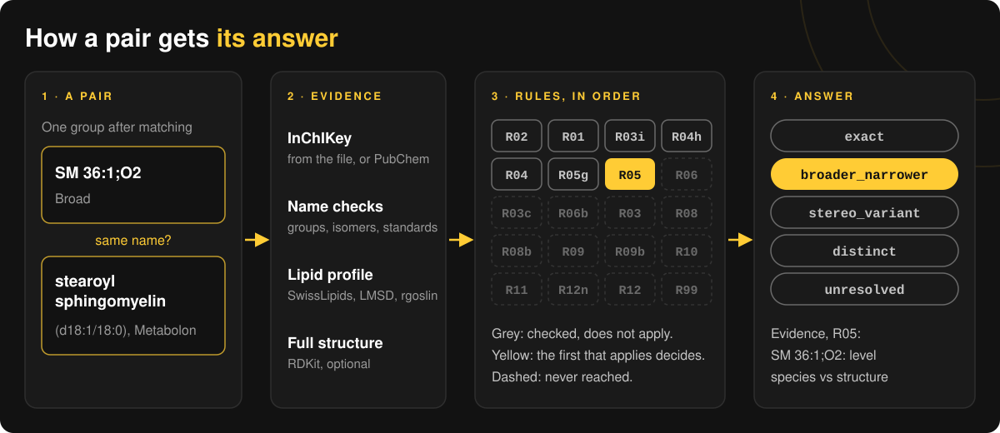
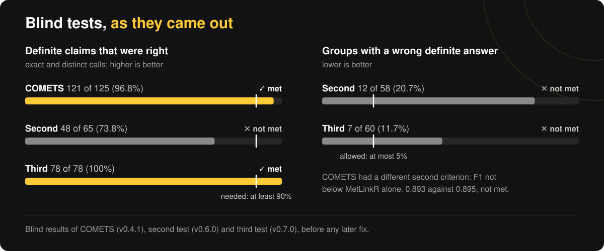

Check whether metabolites matched across datasets are really the same compound.

Tools such as [MetLinkR](https://github.com/ncats/MetLinkR) link metabolomics datasets by giving every row a standardized name. Rows that end up with the same name are treated as one metabolite. metMatchAudit runs after that step. For every pair of rows that share a name, it looks at the structural evidence and reports how the two actually relate, with the rule that decided it. It also proposes lipid matches across vendors that the matching step missed.

Status: v0.9.1, tested in one development review and three blind tests (see [Evaluation](#evaluation)).

## Why

A shared name does not always mean a shared structure. The MetLinkR authors found groupings of compounds reported at different structural resolution, of stereoisomers, and of compounds that are not even isomers (Patt et al., J. Proteome Res. 2025), and advise checking the output by hand. In a manual check of 53 groups from the MetLinkR example data, 13 merged different compounds, among them omega-3 and omega-6 docosapentaenoic acid and 1- and 2-arachidonoylglycerol, and 10 came from errors in a source file. Internal standards were also merged with the metabolites they stand in for.

## What it reports

For each pair of rows in a group, one of:

| relationship | meaning |
|---|---|
| `exact` | same compound, or the same annotation at the same level |
| `broader_narrower` | same compound family, one row reported with less detail |
| `stereo_variant` | same connectivity, different stereochemistry, stated in a name |
| `distinct` | different compounds |
| `unresolved` | the evidence does not settle it |

When the evidence is not enough, the answer is `unresolved`. The tool does not guess. Every result carries a rule ID and a short evidence text, for example:

| row A | row B | relationship | rule | evidence |
|---|---|---|---|---|
| SM 36:1;O2 (Broad) | stearoyl sphingomyelin (d18:1/18:0) (Metabolon) | broader_narrower | R05 | SM 36:1;O2: level species vs structure |
| 2-arachidonoylglycerol (20:4) | 1-arachidonylglycerol (20:4) | distinct | R12 | different connectivity |
| Inosine | Inosine-15N4 [iSTD] | distinct | R02 | one row is an internal standard |
| scyllo-inositol | myo-inositol | unresolved | R03c | identical InChIKey, but the names state different isomers |

## How it decides



Evidence comes only from the source files, fixed parsing rules and versioned database files: the InChIKey (or one derived from a PubChem CID or HMDB ID), text checks on the name, lipid profiles from [SwissLipids](https://www.swisslipids.org), [LIPID MAPS](https://www.lipidmaps.org/databases/lmsd), [rgoslin](https://bioconductor.org/packages/rgoslin/) and the Biocrates p180 nomenclature table, and optionally the full structure through [RDKit](https://www.rdkit.org). The rules run in a fixed order and the first one that applies decides. The rules, with the real case behind each, are in [notes/design.md](notes/design.md).

## Installation

rgoslin comes from Bioconductor, so install it first:

```r
install.packages("BiocManager")
BiocManager::install("rgoslin")
install.packages("remotes")
remotes::install_github("maghasemi/metMatchAudit")
```

Data files, not included in the package:

- SwissLipids `lipids.tsv` from <https://www.swisslipids.org/#/downloads> (about 690 MB, CC BY 4.0). Needed.
- LMSD standard SDF from <https://www.lipidmaps.org/databases/lmsd/download> (about 290 MB unzipped, CC BY 4.0). Optional.

Identifier resolution needs httr2 and jsonlite and internet access on the first run; answers are cached. The structure checks need RDKit through reticulate:

```r
install.packages(c("httr2", "jsonlite", "reticulate"))
reticulate::py_require("rdkit")
```

Without these the audit still runs and skips the parts that need them.

## Usage

MetLinkR does not record which column holds the metabolite name or the identifiers in each file, so you say it:

```r
library(metMatchAudit)

files <- data.frame(
  path         = c("out/Metabolon_metLinkR.csv", "out/Broad_metLinkR.csv", "out/Biocrates_metLinkR.csv"),
  name_col     = c("CHEMICAL_NAME", "Metabolite", "metabolite_name"),
  name_fallback_col = c(NA, "name", NA),          # optional, used where name_col is empty
  inchikey_col = c("INCHIKEY", "inChIKey", NA),
  pubchem_col  = c("PUBCHEM", NA, NA),            # optional
  hmdb_col     = c("HMDB", "hmdbId", NA),         # optional
  vendor       = c(NA, NA, "biocrates_p180")      # optional
)

sl   <- load_swisslipids("lipids.tsv")
lmsd <- load_lmsd("structures.sdf")               # optional
audit <- audit_metlinkr(files, swisslipids = sl, lmsd = lmsd,
                        cache_file = "pubchem_cache.rds")
audit
write_audit(audit, "audit_output")
```

`write_audit()` writes `pairs.csv`, `groups.csv` (the most severe relationship per group), `row_flags.csv`, `rows.csv` (all evidence per row), `lipid_matches.csv` and `run_info.txt` (package version, date, md5 of every database file).

Loading SwissLipids takes about half a minute and LMSD about a minute. Both objects can be kept with `saveRDS()`.

## Evaluation

Each test fixed its criteria and labels before the tool ran on its data. Full results, including what failed, are in [notes/evaluation.md](notes/evaluation.md).



| test | data | result |
|---|---|---|
| development | MetLinkR example data, 53 groups reviewed by hand | 35 agree, 8 unresolved, 0 wrong; no source-error group called exact |
| COMETS, blind (v0.4.1) | 5 datasets with expert mappings | definite claims (exact, distinct) right in 121 of 125 (96.8%); F1 not better than MetLinkR alone |
| second blind test (v0.6.0) | own Metabolon file and Ding et al. 2021 | definite claims right in 48 of 65 (73.8%); 12 of 58 groups with a wrong answer |
| third blind test (v0.7.0) | own Metabolon file and Lai et al. 2021 | definite claims right in 78 of 78; 7 of 60 groups with a wrong answer; 13 of 13 lipid proposals right |

The tool rarely makes a wrong `exact` or `distinct` call on naming styles it knows, and leaves a pair `unresolved` when the evidence is thin. It did not carry over to an unseen naming style (MS-DIAL) in the second test. Its main remaining error is the first limit below.

## Known limits

- `broader_narrower` from rule R09 means one record has stereo and the other does not. Often the names agree and say nothing about stereo ("lactate" and "Lactic acid"), and the difference only reflects which PubChem record each lab chose. If you match by name, treat such a pair as the same compound.
- Rows with only a name, and no identifier the tool can use, get no evidence.
- MS-DIAL-style lipid names are not read.
- The name checks are tuned on Metabolon, Broad, Biocrates and HMDB-style naming.

The full list is in [notes/design.md](notes/design.md).

## Documentation

- [notes/design.md](notes/design.md): inputs, evidence, rules and outputs
- [notes/evaluation.md](notes/evaluation.md): every test and its result
- [notes/decisions.md](notes/decisions.md): plans and criteria, in the order they were committed
- [notes/findings.md](notes/findings.md): what each test showed
- [scripts/README.md](scripts/README.md): the analysis scripts, one folder per stage

## Data sources and references

- Patt A. et al. metLinkR: Facilitating Metaanalysis of Human Metabolomics Data through Automated Linking of Metabolite Identifiers. J. Proteome Res. 2025, 24, 2403-2407.
- Aimo L. et al. The SwissLipids knowledgebase for lipid biology. Bioinformatics 2015, 31, 2860-2866. CC BY 4.0.
- LIPID MAPS Structure Database, <https://www.lipidmaps.org>. Sud M. et al. LMSD: LIPID MAPS structure database. Nucleic Acids Res. 2007, 35, D527-D532. CC BY 4.0.
- Liebisch G. et al. Update on LIPID MAPS classification, nomenclature, and shorthand notation for MS-derived lipid structures. J. Lipid Res. 2020, 61, 1539-1555.
- Kopczynski D. et al. Goslin: A Grammar of Succinct Lipid Nomenclature. Anal. Chem. 2020, 92, 10957-10960.
- biocrates life sciences ag. AbsoluteIDQ p180 kit, old vs. new nomenclature (v1-2023).
- PubChem, <https://pubchem.ncbi.nlm.nih.gov>, through PUG REST.
- RDKit: Open-source cheminformatics, <https://www.rdkit.org>.
- COMETS expert mappings: `ManualMappings.csv` from the supplement of Patt et al. 2025 (above).
- Ding J. et al. A metabolome atlas of the aging mouse brain. Nat. Commun. 2021, 12. DOI 10.1038/s41467-021-26310-y. Annotation table used in the second blind test.
- Lai Y. et al. High-coverage metabolomics uncovers microbiota-driven biochemical landscape of interorgan transport and gut-brain communication in mice. Nat. Commun. 2021, 12. DOI 10.1038/s41467-021-26209-8. Supplementary Data 2 and 3, used in the third blind test and included in `data-raw/lai2021/` under CC BY 4.0.

## AI usage

This project was developed with the help of an AI assistant, Claude Opus 5.5 (Anthropic), at medium effort. The assistant drafted most of the code, tests, scripts and documentation, and the first proposals for the labels of the second and third blind tests. The author set the goals, chose the data, reviewed and approved every plan, criterion, label and change before it was committed, and ran all scripts and tests on his own machine. The plans, criteria and results are logged in `notes/decisions.md` and `notes/findings.md` in the order they were made.

## License

MIT. SwissLipids and LMSD data are not included and keep their own license (CC BY 4.0). The Biocrates nomenclature table in `inst/extdata` lists analyte names from the vendor's published document.

Amin Ghasemi
